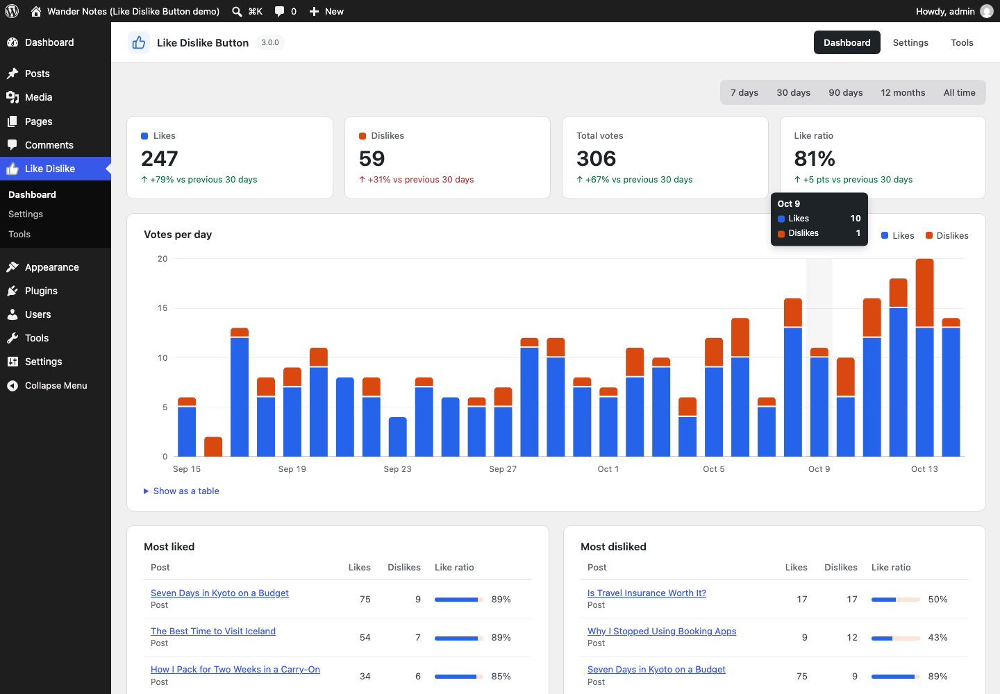
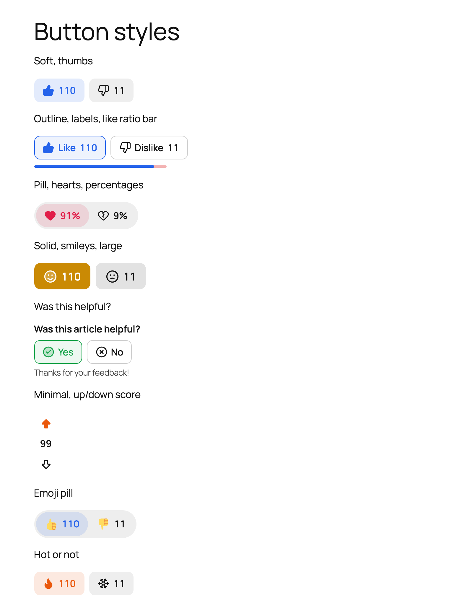
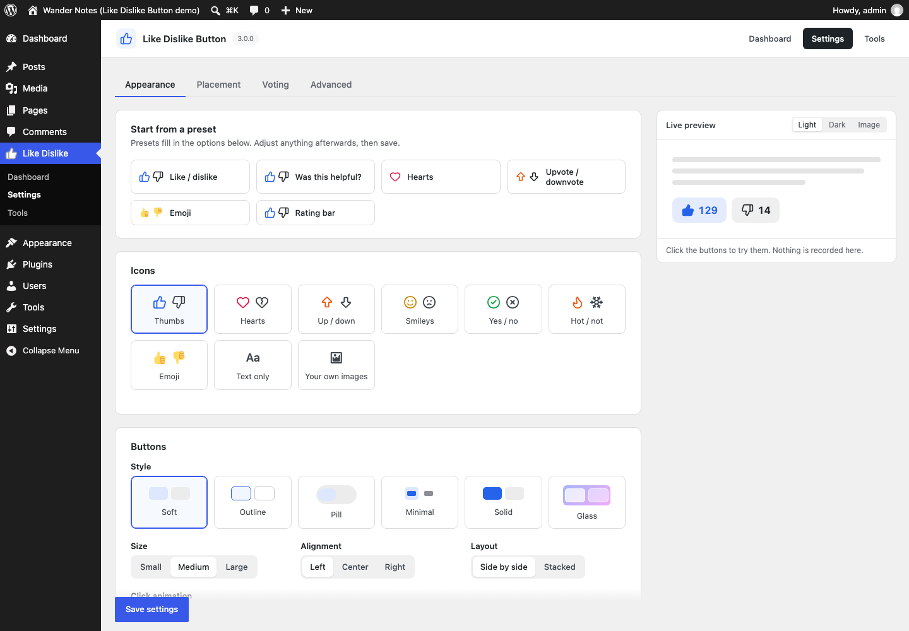

# Like Dislike Button

Like and dislike buttons for WordPress posts, pages, WooCommerce products,
custom post types and comments. Nine icon sets, six styles, a block that works
inside Query Loop, a Most Liked Posts list, vote analytics, one-click import
from other like plugins, and like counts in your schema.org markup. Works with
page caching.



<p>


</p>

---

## The concept

Most like plugins break in one of three places.

1. **Page caching.** The buttons are rendered with the page, so a cached page
   shows yesterday's counts, and the visitor's own vote is forgotten. Here the
   page can be cached as usual: counts and the visitor's vote load through one
   small REST request after the page loads, for every widget on the page at once.
2. **Counting.** A cookie or an IP list in post meta is easy to inflate and
   impossible to analyse. Here every vote is one row (who, what, when), so a
   vote can be switched or removed, logged-in users keep their vote across
   devices, and the dashboard can show any period. Totals are cached in meta, so
   lists and sorting never touch the votes table.
3. **Switching plugins.** Your existing votes are stuck in the old plugin. Here
   they can be imported in one click, with dates, and the old shortcodes keep
   working.

---

## How it works

```
Page (cacheable)                       REST API (never cached)
  .ldb[data-ldb-type][data-ldb-id]  ─→  GET  /ldb/v1/state?items=post:12,comment:5
                                     ←─  totals + this visitor's vote for each item
  click                             ─→  POST /ldb/v1/vote {type, id, reaction}
                                         └─ checks: item public, reaction on,
                                            login/role rules, 30 votes/min per network
                                         └─ insert / switch / remove one row
                                         └─ recount that item → meta
```

**Who is a voter.** Logged-in users are keyed by account (`u:42`). Visitors are
keyed by a random ID in a cookie set on their first vote, or by IP, as chosen in
settings. Cookie IDs and IPs are only ever stored as a keyed HMAC, never as-is.
One row per voter per item is enforced by a unique key, and a short MySQL lock
stops double clicks from counting twice.

**Storage.** `{prefix}ldb_votes` holds one row per current vote. Totals live in
`_ldb_likes`, `_ldb_dislikes` and `_ldb_score` (post or comment meta). Imports
from plugins that only kept totals sit in `_ldb_imported`, so a recount never
loses them.

**Structured data.** Totals are added to the page's existing Article or WebPage
entity as `interactionStatistic` (LikeAction and DislikeAction). Yoast SEO,
Rank Math and All in One SEO are extended through their schema filters. Any other
theme or plugin that prints JSON-LD in the head has its matching entity extended
in place. A page with no JSON-LD gets a small WebPage entity. Nothing is added
when counts are hidden.

**Front end.** About 9 KB of plain, unminified JavaScript and no jQuery. Buttons are real
`<button>` elements with `aria-pressed`, announcements go to a live region, and
animations are skipped for visitors who prefer reduced motion. Colours are CSS
custom properties that mix from `currentColor`, so the default look works on
light and dark themes.

---

## Features

| | |
|---|---|
| **Look** | 9 icon sets (thumbs, hearts, up/down, smileys, yes/no, hot/not, emoji, text, your own images), 6 styles (soft, outline, pill, minimal, solid, glass), 3 sizes, alignment, side-by-side or stacked, colours, pop/bounce/burst animations |
| **Counts** | shown, hidden, after voting, percentages or a single score; 1.2K short numbers; like ratio bar |
| **Presets** | Like / dislike, Was this helpful?, Hearts, Upvote / downvote, Emoji, Rating bar, all with a live preview |
| **Placement** | any post type, comments, WooCommerce products, before/after content, block (Query Loop and site editor), shortcode, template tag, Elementor widget |
| **Voting** | change or remove a vote, like-only mode, logged-in only, role limits, per-browser or per-IP visitors, proxy and Cloudflare IP headers, rate limit |
| **Analytics** | 7/30/90 days, 12 months or all time, change vs previous period, votes per day, most liked and disliked, sortable posts column, dashboard widget, CSV export |
| **Import** | WP ULike (vote by vote), Like Dislike for WP (vote by vote), Posts Like Dislike (totals), Like / Dislike Button 2.x |
| **Privacy** | hashed IPs only, cookie set only on voting, WordPress export and erase tools, privacy policy text, no external requests |
| **Developers** | REST API, `ldb_votes` REST field, hooks, WP-CLI, template tags, CSS custom properties |

### Shortcodes and template tags

```text
[like_dislike_button]
[like_dislike_button id="42" icons="hearts" style="pill" counts="percent"]
[like_dislike_button style="outline" labels="yes" like_label="Yes" dislike_label="No" question="Was this helpful?"]
[ldb_most_liked number="5" period="month" show_thumbnail="yes"]
```

```php
<?php if ( function_exists( 'ldb_buttons' ) ) { ldb_buttons(); } ?>
<?php $counts = ldb_get_counts( get_the_ID() ); // ['likes' => 12, 'dislikes' => 3] ?>
```

### Hooks

| Hook | Type | Use |
|---|---|---|
| `ldb_vote_recorded` | action | `( $type, $id, $vote, $previous, $user_id, $counts )` after any vote change |
| `ldb_can_vote` | filter | return a `WP_Error` to block a vote |
| `ldb_buttons_html` | filter | change the buttons markup |
| `ldb_icon_sets` | filter | add an icon set (24×24 stroked SVG paths) |
| `ldb_visitor_ip` | filter | supply the real visitor IP behind a proxy |
| `ldb_rate_limit` | filter | votes per minute per network, `0` to turn off |
| `ldb_schema_statistics` | filter | change or remove the `interactionStatistic` entries |

### WP-CLI

```bash
wp ldb stats --days=30         # totals and top posts
wp ldb sources                 # other like plugins found on this site
wp ldb import wp-ulike         # import votes
wp ldb recount                 # rebuild every total
wp ldb reset --post=42         # delete one post's votes
```

---

## Development

No build step. The blocks are plain JavaScript (`blocks/*/index.js`) using the
`wp.*` globals, with dependencies listed in `index.asset.php`.

```
like-dislike-button.php      bootstrap
includes/
  class-ldb-votes.php        casting, counting, recounting, voter identity
  class-ldb-render.php       button markup, automatic placement, shortcodes
  class-ldb-rest.php         ldb/v1/state, ldb/v1/vote, ldb_votes field
  class-ldb-schema.php       interactionStatistic in schema.org markup
  class-ldb-blocks.php       Buttons and Most Liked blocks
  class-ldb-stats.php        dashboard queries
  class-ldb-importer.php     imports from other plugins
  admin/                     dashboard, settings, tools, meta box, list column
assets/                      front-end and admin CSS/JS
blocks/                      block.json + editor scripts
bin/
  build-zip                  builds the WordPress.org package
  build-blueprint            builds the Playground Live Preview
  blueprint-demo.php         demo content for the Live Preview
.wordpress-org/              banner, icons, screenshots, blueprint (SVN assets/)
```

`./bin/build-zip` is the single source of truth for what ships. It leaves out
`bin/`, `README.md`, `.wordpress-org/` and every hidden file, and writes the zip
next to the plugin folder rather than inside it.

To try the Live Preview locally with your working copy mounted:

```bash
./bin/build-blueprint --local /tmp/ldb-blueprint.json
npx @wp-playground/cli@latest server --blueprint=/tmp/ldb-blueprint.json \
  --mount="$PWD:/wordpress/wp-content/plugins/like-dislike-button"
```

## Release

1. Bump `Version` in `like-dislike-button.php`, `LDB_VERSION`, and `Stable tag` in `readme.txt`.
2. Commit and push to `main`.
3. Tag it: `git tag v3.0.0 && git push origin v3.0.0`.

The tag runs `.github/workflows/deploy.yml`. It checks that the tag, `Stable tag`
and plugin `Version` match, builds with `bin/build-zip`, and deploys to SVN
`trunk` and `tags/X.Y.Z`. It also syncs `.wordpress-org/` to SVN `assets/`. It
needs the repository secrets `SVN_USERNAME` (the exact WordPress.org login,
`Sanju Shankar`) and `SVN_PASSWORD` (the SVN password from your WordPress.org
profile).

## Credits

Icons are adapted from [Lucide](https://lucide.dev) (ISC licence).

## License

GPLv2 or later. See [LICENSE](LICENSE).
